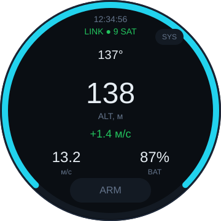

# dropla-c2-display

Экран C2 (command & control) для дрона на плате **Waveshare ESP32-S3-Touch-LCD-1.85**:
круглый 1.85″ дисплей 360×360, ёмкостный тач, IMU, RTC, PSRAM 8 МБ, Wi-Fi/BLE.

Прошивка — **Arduino (arduino-esp32 3.3.12) + LVGL 8.3**, сборка через `arduino-cli`,
который уже входит в Arduino IDE 2.x.

<p align="center">
  
</p>

## Что умеет пример

Свой UI (`firmware/c2_display`), две страницы:

**Полёт**
- кольцо-компас по краю экрана (курс);
- высота крупно + вариометр (зелёный/красный);
- скорость, заряд АКБ в процентах, состояние связи и число спутников;
- кнопка `ARM` / `DISARM`.

**Система**
- акселерометр (ACC X/Y), гироскоп (GYRO Z);
- дата/время с RTC PCF85063 (или аптайм, если часы не выставлены);
- напряжение АКБ, свободная RAM/PSRAM, аптайм.

Данные телеметрии сейчас **имитируются** (`C2_SIMULATE 1` в `telemetry.cpp`); заряд,
IMU, RTC и память — настоящие. Для живых данных достаточно заполнять `telemetry_t`
из своего канала связи (Wi-Fi/MAVLink/MQTT) и выставить `C2_SIMULATE 0`.

## Железо

| Что | Как подключено |
|---|---|
| MCU | ESP32-S3, 240 МГц, 16 МБ flash, 8 МБ OPI PSRAM |
| Дисплей | ST77916, 360×360, QSPI на SPI2 (SCK 40, D0–D3 46/45/42/41, CS 21, TE 18) |
| Подсветка | GPIO 5, LEDC 20 кГц |
| Тач | CST816S, I2C 0x15 (SDA 1, SCL 3, INT 4) |
| IO-расширитель | TCA9554 (0x20): EXIO1 — reset тача, EXIO2 — reset дисплея |
| IMU | QMI8658 (0x6B), RTC PCF85063 (0x51) — общая I2C (SDA 11, SCL 10) |
| АКБ | ADC GPIO 8 |

Подробная распиновка и все подводные камни — в [`docs/board-notes.md`](docs/board-notes.md).

## Требования

1. **Arduino IDE 2.x** — https://www.arduino.cc/en/software
   (даёт `arduino-cli` по пути `%LOCALAPPDATA%\Programs\Arduino IDE\resources\app\lib\backend\resources\arduino-cli.exe`).
2. **Ядро esp32 3.3.12** (Boards Manager: `esp32` by Espressif).
3. **Библиотека LVGL 8.3.x** в `Documents\Arduino\libraries\lvgl`
   (Library Manager → “lvgl” by kisvegabor, версия **8.3.x**, не 9.x — API другой).
4. Windows + PowerShell (скрипт сборки), драйвер USB-Serial/JTAG для ESP32-S3
   (в Windows 10/11 ставится сам, порт виден как `USB Serial Device (COMx)`).

> Плата подключается нативным USB (VID:PID `303A:1001`), в диспетчере устройств это
> «USB JTAG/serial debug unit» + COM-порт. В Arduino IDE скорость загрузки 921600 работает.

## Подготовка окружения

```powershell
# 1. клонировать
git clone https://github.com/baden/dropla-c2-display.git
cd dropla-c2-display

# 2. поставить ядро и LVGL (один раз)
$cli = "$env:LOCALAPPDATA\Programs\Arduino IDE\resources\app\lib\backend\resources\arduino-cli.exe"
& $cli config add board_manager.additional_urls https://espressif.github.io/arduino-esp32/package_esp32_index.json
& $cli core update-index
& $cli core install esp32:esp32@3.3.12
& $cli lib install "lvgl@8.3.10"
```

Скрипт сборки сам синхронизирует `firmware/lv_conf.h` с библиотекой
(`Documents\Arduino\libraries\lvgl\src\lv_conf.h`) — вручную ничего копировать не нужно.

## Сборка и прошивка

```powershell
# свой экран C2 (по умолчанию COM4)
.\tools\build.ps1 -Sketch firmware\c2_display -Upload

# другой порт
.\tools\build.ps1 -Sketch firmware\c2_display -Upload -Port COM5

# демо производителя Waveshare
.\tools\build.ps1 -Sketch firmware\LVGL_Arduino -Upload

# тест панели без LVGL: красный → зелёный → синий → белый → чёрный
.\tools\build.ps1 -Sketch firmware\00_display_test -Upload
```

Только собрать, без заливки — убрать `-Upload`.

### Через Arduino IDE (GUI)

Если хочется жать кнопки в IDE:

1. File → Open → `firmware/c2_display/c2_display.ino`.
2. Tools → Board → **ESP32S3 Dev Module**, порт — свой COM.
3. Настройки платы (обязательно все):

   | Опция | Значение |
   |---|---|
   | USB Mode | Hardware CDC and JTAG |
   | USB CDC On Boot | Enabled |
   | CPU Frequency | 240 MHz |
   | Flash Mode | QIO 80 MHz |
   | Flash Size | 16MB (128Mb) |
   | PSRAM | **OPI PSRAM** |
   | Partition Scheme | **Custom** (возьмёт `partitions.csv` из папки скетча) |
   | Upload Speed | 921600 |

4. Скопировать `firmware/lv_conf.h` в `Documents\Arduino\libraries\lvgl\src\lv_conf.h`
   (иначе LVGL возьмёт свой конфиг из библиотеки и не найдёт шрифты/демо-ассеты).
5. Upload.

### Командная строка без скрипта

```powershell
$fqbn = "esp32:esp32:esp32s3:USBMode=hwcdc,CDCOnBoot=cdc,PSRAM=opi,FlashSize=16M,PartitionScheme=custom,CPUFreq=240,FlashMode=qio"
arduino-cli compile -b $fqbn --build-path .build\c2_display firmware\c2_display
arduino-cli upload  -b $fqbn -p COM4 --input-dir .build\c2_display
```

## Структура

```
firmware/
  c2_display/          свой UI (основной пример)
    ui.cpp/.h          весь UI: страница «полёт» и «система»
    telemetry.cpp/.h   модель данных + симулятор
    lvgl_port.cpp/.h   LVGL ↔ ST77916 (flush), тач CST816S, тик от esp_timer
    Display_ST77916.*  драйвер панели QSPI
    Touch_CST816.*     драйвер тача
    TCA9554PWR.*       IO-расширитель (reset LCD/тача)
    QMI8658.* / PCF85063.* / BAT_Driver.* / PWR_Key.*
  LVGL_Arduino/        демо производителя (часы, виджеты, IMU)
  00_display_test/     минимальный тест панели, без LVGL
  lv_conf.h            единый конфиг LVGL (16 bpp, 64 КБ heap, шрифты 12…48)
  partitions-16mb.csv  app 6 МБ / model 3.9 МБ / ffat 6 МБ
tools/build.ps1        сборка + заливка (arduino-cli из Arduino IDE)
docs/board-notes.md    распиновка, грабли, пояснения
```

## Как это работает

- **Дисплей.** `LCD_Init()` поднимает QSPI на 80 МГц и инициализирует ST77916 (драйвер
  `esp_lcd_st77916` из демо Waveshare). LVGL отдаёт готовые области в `LCD_addWindow()`,
  который байт-свапает RGB565 под панель.
- **Буферы LVGL.** Два буфера по 40 строк (`360 × 40 × 2 байта` ≈ 28 КБ каждый) в
  внутренней RAM — PSRAM для SPI-DMA на S3 не подходит. Включена частичная перерисовка.
- **Тач.** Опрос CST816S по I2C в `read_cb` LVGL; сброс — через TCA9554 EXIO1.
- **Питание/подсветка.** `PWR_Key` держит линию питания (GPIO7) и обрабатывает
  долгое нажатие кнопки; подсветка — LEDC на GPIO5.

## Если что-то не так

| Симптом | Причина / решение |
|---|---|
| Экран чёрный, в логе всё ок | нет `TCA9554PWR_Init()` до `LCD_Init()` — reset дисплея висит на расширителе |
| `Guru Meditation ... LoadProhibited` после `MODEL_LOADER` | включено распознавание речи без раздела `model`/`srmodels.bin`; оставьте `ENABLE_SPEECH_RECOGNITION 0` |
| `text section exceeds available space` | 3 МБ app мало (демо ~4.1 МБ); нужен `PartitionScheme=custom` + `partitions.csv` |
| `lv_font_montserrat_48 was not declared` | LVGL компилируется со своим `src/lv_conf.h` — синхронизируйте `firmware/lv_conf.h` туда |
| `img_lvgl_logo: undefined reference` в демо | в `lv_conf.h` нужен `LV_USE_DEMO_WIDGETS 1` (демо тянет ассеты виджетов) |
| `SD card initialization failed` | SD-карты нет — это нормально, демо продолжает работу |
| Порт не появляется | кабель только с зарядкой / нет драйвера USB-Serial-JTAG; кнопка BOOT + RESET |

## Что дальше

- живые данные: Wi-Fi STA + WebSocket/MQTT/MAVLink → `telemetry_t`;
- страница трендов (`lv_chart`), тревоги «нет связи / низкий заряд»;
- калибровка IMU, установка времени RTC, яркость — страница настроек;
- голосовые команды: `ENABLE_SPEECH_RECOGNITION 1` + залить `srmodels.bin` в раздел
  `model` (см. `docs/board-notes.md`), но свободной RAM останется очень мало.

## Ссылки

- Плата: https://www.waveshare.com/esp32-s3-touch-lcd-1.85.htm
- LVGL 8.3 docs: https://docs.lvgl.io/8.3/
- arduino-esp32: https://github.com/espressif/arduino-esp32
- Демо производителя (архив ~190 МБ, не в git): `ESP32-S3-Touch-LCD-1.85-Demo.zip`
  с сайта Waveshare → распаковать в `vendor/`, если нужны исходники ESP-IDF-версии.
